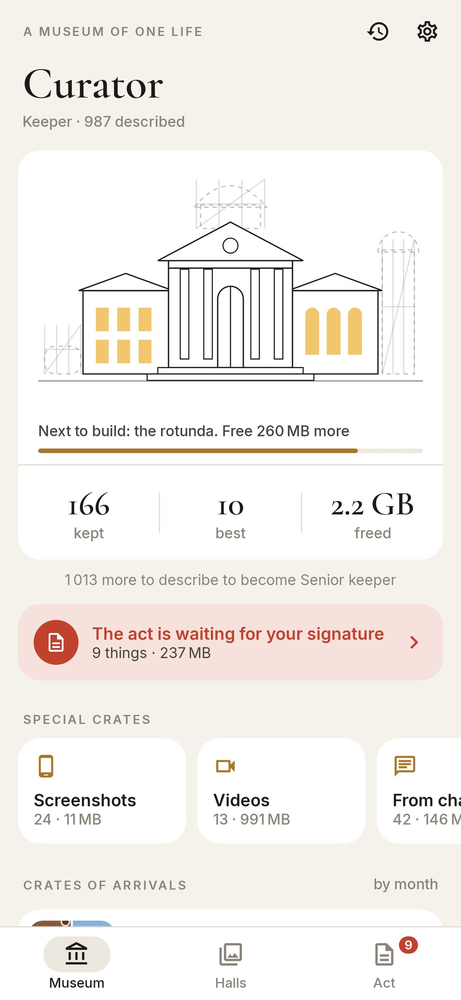
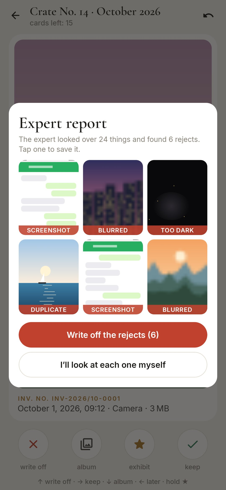
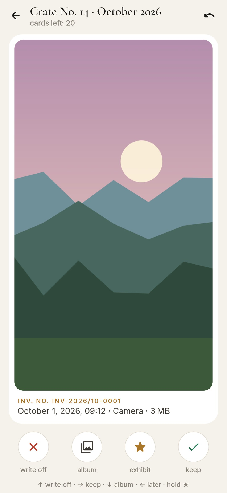
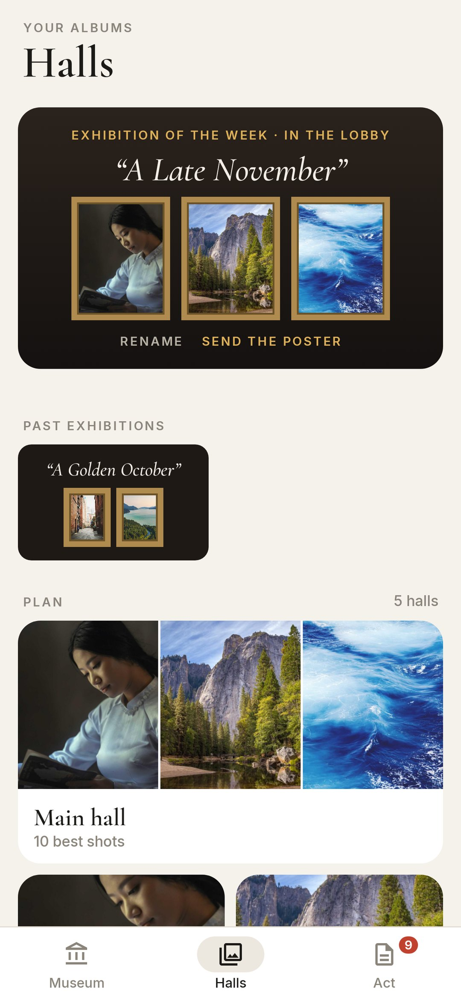

<div align="center">


# Curator

### Sort your phone's gallery like the storeroom of a museum

*Thousands of photos wait in crates, one crate per month. Open one at a time: twenty-odd cards, a couple of minutes. One gesture per thing: write it off, keep it, put it into an album, mark it as one of the best. Nothing is deleted until you sign the act of write-off, and the space you free builds the museum, wing by wing. Free, no ads, no internet.*

[](https://github.com/bigdevwhale/curator/actions/workflows/android.yml)


[](LICENSE)

**English** · [Русский](README.ru.md) · [Changelog](CHANGELOG.md)

   

**[Download the APK](https://github.com/bigdevwhale/curator/releases/latest/download/Curator.apk)** · Android 11+

</div>

---

## A crate at a time

- **Crates by month.** The gallery arrives as crates of arrivals, one per month, each with how much is still undescribed. Special collections cut across the months: screenshots, videos (heaviest first), pictures from chats, everything over 20 MB.
- **The expert goes first.** Before you start, blurred shots, pocket shots in the dark, screenshots and exact duplicates are put aside on the phone itself (Laplacian sharpness, brightness, a difference hash). You confirm with one button, or tap any of them to save it.
- **Series.** Five near-identical shots taken within a minute come as one card: pick the original, the copies go into the act.
- **One gesture.** ↑ write off · → keep · ↓ into an album · ← later · hold to mark it as one of the best. The same as buttons, and **undo** takes back the last card.
- **An inventory card** for every thing: its number (КП-2021/03-0147), date and time, folder and size. A tap shows the whole photo; a video plays in the phone's player.

## Nothing is lost by accident

- **The act of write-off.** Everything written off waits in the act. Look at any thing again or keep it after all. When you sign, Android asks once for the whole act (`MediaStore.createDeleteRequest`).
- **No internet permission.** Photos never leave the phone; the expert looks at small thumbnails right here.

## The museum grows

- **Wings for freed space.** The building stands in scaffolding: the wing opens at 250 MB, the gallery at 1 GB, the rotunda at 2.5 GB, the observatory at 5 GB, the sculpture garden at 10 GB. Each gets its ribbon.
- **Ranks for described things**, from attendant to museum director.
- **Halls** are your albums. A hall can become a real one: its photos move to `Pictures/<hall>` and every gallery app shows it as an album.
- **The exhibition of the week**: this week's best shots on a poster under its own title, to rename and send.
- **Out of the stores**: a thing taken on this very day in an earlier year.
- **The chronicle** of everything the museum has lived through.
- A morning note while crates are waiting, if you want one.

## Build

```
./gradlew assembleDebug                      # app.curator.dev
./gradlew assembleDebug -Pdemo               # app.curator.demo: a made-up gallery drawn in code
./gradlew testDebugUnitTest                  # the expert's logic
./gradlew testDebugUnitTest -Prender --tests '*RenderScreens*' && python tools/shots.py   # screenshots
python tools/res.py                          # strings, EN and RU, from one table
```

Kotlin, Jetpack Compose, Room, DataStore, WorkManager. Fonts: Cormorant Garamond, PT Serif, PT Sans Narrow (SIL OFL).

Part of [StillCraft](https://bigdevwhale.github.io/stillcraft/). MIT licence.

Photos in the training crate are from [Unsplash](https://unsplash.com/license): Steven Lewis, Roberto Nickson, Matthew Wiebe, Jeff Sheldon, Alexey Topolyanskiy, E+N Photographies.
