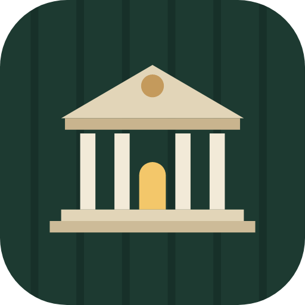
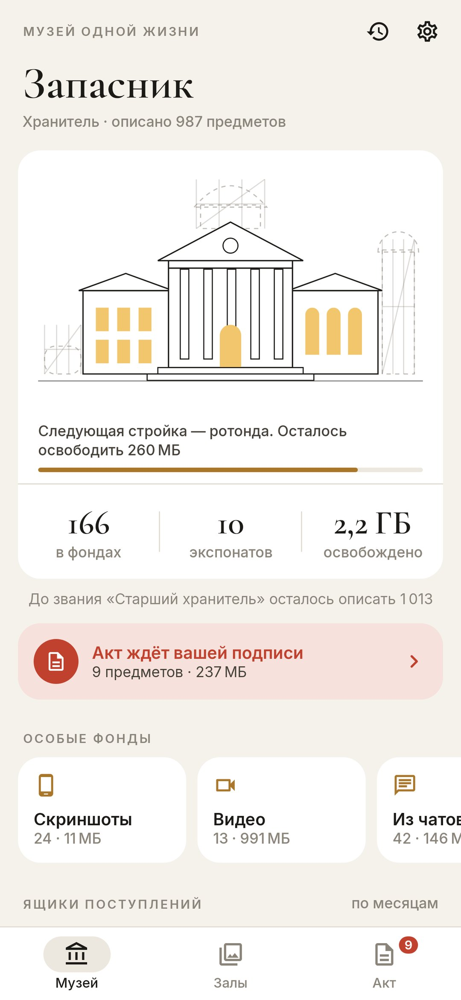
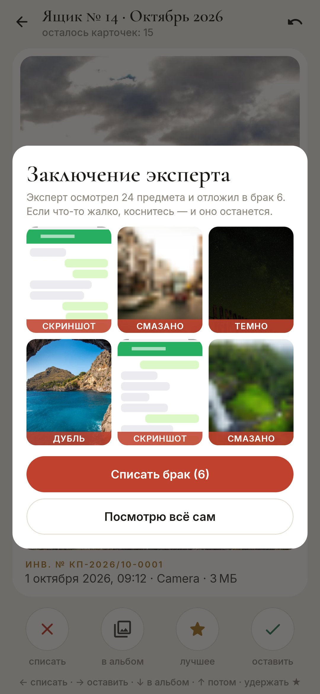
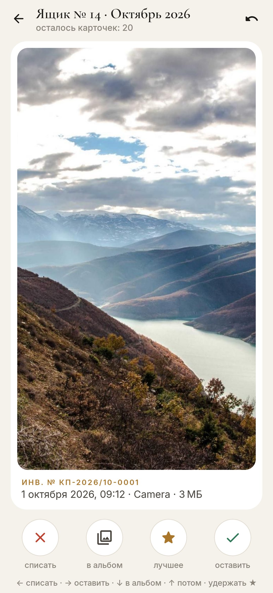
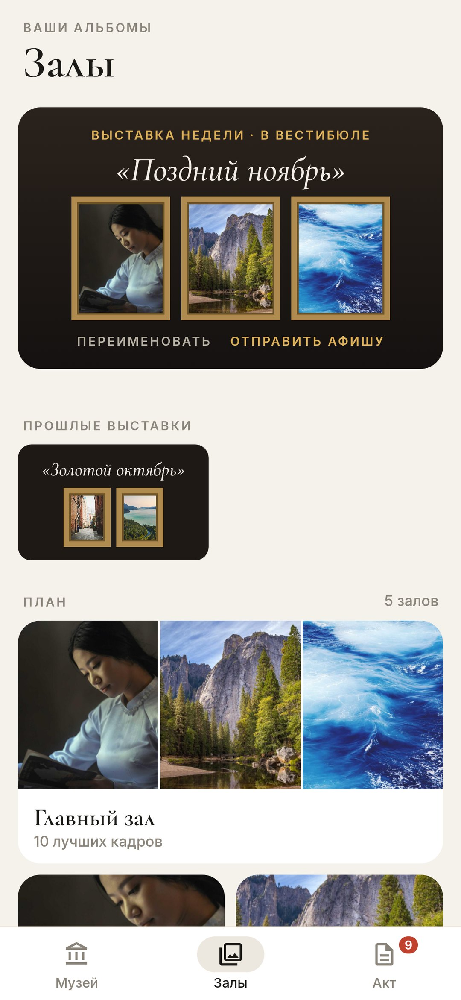

# Куратор

### Разбор галереи телефона как работа хранителя музея

*Тысячи фотографий лежат в ящиках — по ящику на месяц. Вскрывайте по одному: пара десятков карточек, пара минут. Один жест на предмет: списать, оставить, положить в альбом, отметить лучшее. Пока акт списания не подписан, ничего не удаляется, а освобождённое место достраивает музей — крыло за крылом. Бесплатно, без рекламы, без интернета.*

[English](README.md) · **Русский** · [Изменения](CHANGELOG.md)

   

**[Скачать APK](https://github.com/bigdevwhale/curator/releases/latest/download/Curator.apk)** · Android 11+

---

## По ящику за раз

- **Ящики по месяцам.** Галерея приходит ящиками поступлений, у каждого видно, сколько ещё не описано. Особые ящики идут поперёк месяцев: скриншоты, видео (самые тяжёлые — первыми), картинки из мессенджеров, всё тяжелее 20 МБ.
- **Сначала эксперт.** Смазанное, снятое в кармане, скриншоты и точные дубли откладываются заранее, прямо на телефоне. Вы подтверждаете одной кнопкой или спасаете любой предмет касанием.
- **Серии.** Пять почти одинаковых кадров за минуту приходят одной карточкой: выберите подлинник, копии уйдут в акт.
- **Один жест.** ← списать · → оставить · ↓ в альбом · ↑ отложить · удержать — в лучшее. То же самое кнопками, а «вернуть» отменяет последнюю карточку.
- **Инвентарная карточка** у каждого предмета: номер (КП-2021/03-0147), дата и время, папка и вес.

## Случайно ничего не пропадёт

- **Акт списания.** Всё списанное ждёт в акте: можно рассмотреть ещё раз или всё-таки оставить. При подписи Android спрашивает один раз — за весь акт.
- **Нет доступа в интернет.** Фото не покидают телефон.

## Музей растёт

- **Крылья за освобождённое место**: флигель — 250 МБ, галерея — 1 ГБ, ротонда — 2,5 ГБ, обсерватория — 5 ГБ, сад скульптур — 10 ГБ.
- **Звания за описанные предметы** — от смотрителя до директора музея.
- **Залы** — ваши альбомы. Зал можно сделать настоящим: фото переедут в папку `Pictures/<зал>`, и любая галерея покажет его как альбом.
- **Выставка недели**: лучшие кадры недели на афише под своим названием — её можно переименовать и отправить.
- **Из запасника**: кадр, снятый в этот самый день в прошлые годы.
- **Летопись** музея и утренняя записка, если ящики ждут.

Часть [StillCraft](https://bigdevwhale.github.io/stillcraft/). Лицензия MIT.

Фото в учебном ящике — с [Unsplash](https://unsplash.com/license): Steven Lewis, Roberto Nickson, Matthew Wiebe, Jeff Sheldon, Alexey Topolyanskiy, E+N Photographies.

Фото демо-галереи и скриншотов — тоже с [Unsplash](https://unsplash.com/license), через [Lorem Picsum](https://picsum.photos); авторы перечислены в [CREDITS.txt](app/src/demo/assets/demo/CREDITS.txt). Они попадают только в демо-сборки, в релизный APK — нет.
